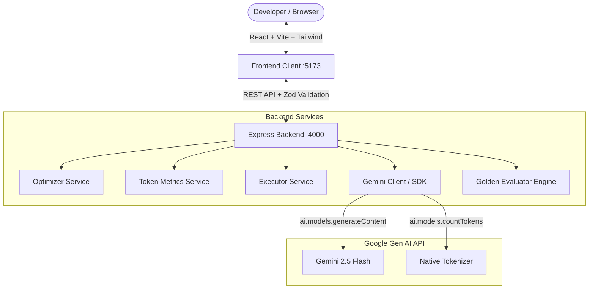

# OptiPrompt — Prompt Optimization & Token Efficiency Engine

OptiPrompt is a production-grade, demo-ready developer tool and prompt optimization engine powered by the official Google Gen AI SDK (`@google/genai`). It transforms raw user prompts into two meaning-preserving alternatives—a **High-Context variant** and a **Low-Token variant**—measures them against Gemini's native `models.countTokens` API, and provides a side-by-side comparison dashboard before executing the approved prompt.

---

## 1. Problem & Solution

### The Problem
* **Token Waste & Latency**: Users often submit repetitive, bloated, or conversational prompts filled with polite filler ("please", "could you help me"), driving up input token costs and model latency.
* **Omitted Constraints & Ambiguity**: Unstructured prompts omit formatting requirements, negative constraints ("do not use external packages"), or target audience criteria.
* **Opaque Pre-execution Analytics**: Developers lack upfront, native token analytics before submitting a task to a language model.

### The Solution: Two-Phase Pipeline
OptiPrompt enforces a strict **two-phase workflow**:
1. **Phase 1 — Optimize & Compare**: The raw prompt is analyzed for intent, negative constraints, and exact literals (keys, regexes, paths). The Gemini engine produces:
   - **High-Context Variant**: Adds structured sections (Objective, Context, Constraints, Format, Criteria) without hallucinating unmentioned facts or libraries.
   - **Low-Token Variant**: Eliminates filler and redundancy while strictly retaining 100% of material constraints and literals.
   - Both variants and the original prompt are measured concurrently via Gemini's native `models.countTokens` API.
2. **Phase 2 — Execute Selected Variant**: The user reviews the 3-column dashboard, edits any prompt in-place if desired, and executes the exact approved prompt. Only the approved text is dispatched as the final user task.

---

## 2. System Architecture



---

## 3. Technology Stack

| Layer | Technologies | Role |
| :--- | :--- | :--- |
| **Frontend** | React 18, TypeScript, Vite, Tailwind CSS, Lucide React | Modern dark-mode UI, editable variants, token bars, feedback widget |
| **Frontend Testing** | Vitest, React Testing Library, jsdom | Component assertions, copy/edit state, validation checks |
| **Backend** | Node.js (v22+), Express 4, TypeScript, Zod | Central error handling, request ID tracing, rate limiting |
| **AI Integration** | `@google/genai` (Official Google Gen AI SDK) | Structured generation and native model token counting |
| **Backend Testing** | Vitest, Supertest | Fast, deterministic unit & integration tests (runs offline without API key) |
| **Evaluation** | Custom Evaluator + 20 Golden Cases | Offline invariant assertions, rubric scoring, live model evaluation |

---

## 4. API Endpoints

### 1. `GET /api/health`
Returns service status and configuration without leaking secrets.
```json
{
  "status": "ok",
  "service": "OptiPrompt API",
  "model": "gemini-2.5-flash",
  "hasApiKey": true,
  "historyEnabled": false,
  "version": "1.0.0"
}
```

### 2. `POST /api/optimize`
Validates the raw prompt, generates High-Context and Low-Token variants, and counts tokens concurrently.
* **Request:**
```json
{
  "rawPrompt": "Extract name and age from the text. Return valid JSON only with keys name and age. No Markdown, no extra keys.",
  "taskCategory": "Data Extraction",
  "model": "gemini-2.5-flash"
}
```
* **Response (Schema):**
```json
{
  "success": true,
  "data": {
    "requestId": "94e82b7b-ca59-4673-8cb4-8178ad0060fb",
    "model": "gemini-2.5-flash",
    "intentSummary": "Extract name and age into valid JSON without markdown wrapping",
    "taskCategory": "Data Extraction",
    "detectedConstraints": {
      "mustPreserve": ["name", "age", "valid JSON only"],
      "outputFormat": "JSON",
      "lengthLimit": null,
      "language": "en",
      "mustAvoid": ["Markdown", "extra keys"],
      "exactLiterals": ["name", "age"]
    },
    "rawPrompt": "Extract name and age from the text. Return valid JSON only with keys name and age. No Markdown, no extra keys.",
    "highContext": "Objective: Extract entities from input text.\nTarget Fields:\n- name\n- age\nConstraints:\n- Output format: Valid JSON only.\n- Prohibited: Do not wrap in Markdown code blocks.",
    "lowToken": "Extract name and age from text. Return valid JSON only with keys name and age. No Markdown, no extra keys.",
    "warnings": [],
    "recommendation": {
      "variant": "highContext",
      "reason": "Explicit JSON schema reduces hallucination of unwanted keys."
    },
    "metrics": {
      "rawTokens": 28,
      "highContextTokens": 45,
      "lowTokenTokens": 24,
      "highContextChangePercent": 60.7,
      "lowTokenReductionPercent": 14.3,
      "measuredWith": "Gemini Native API (gemini-2.5-flash)",
      "costEstimate": {
        "inputCost": 0.000002,
        "currency": "USD",
        "isEstimate": true,
        "assumptions": [
          "Cost reflects input prompt token rate ($0.075 / 1M tokens for <= 128k prompt context)",
          "Estimate excludes prompt caching discounts and output generation fees"
        ]
      }
    }
  }
}
```

### 3. `POST /api/execute`
Executes the exact prompt approved or edited by the user.
* **Request:**
```json
{
  "prompt": "Extract name and age from text. Return valid JSON only with keys name and age.",
  "variantType": "lowToken"
}
```
* **Response:**
```json
{
  "success": true,
  "data": {
    "requestId": "exec_1740000000",
    "prompt": "Extract name and age from text. Return valid JSON only with keys name and age.",
    "response": "{\"name\": \"John Doe\", \"age\": 29}",
    "model": "gemini-2.5-flash",
    "latencyMs": 420,
    "usage": {
      "promptTokens": 18,
      "candidateTokens": 14,
      "totalTokens": 32
    },
    "timestamp": "2026-10-24T12:00:00.000Z"
  }
}
```

### 4. `POST /api/feedback`
Records optional user feedback without altering model weights.
```json
{
  "requestId": "94e82b7b-ca59-4673-8cb4-8178ad0060fb",
  "variantType": "lowToken",
  "rating": "helpful",
  "reason": "Preserved JSON keys perfectly."
}
```

---

## 5. Setup & Running Instructions

### Prerequisites
* **Node.js**: v20 or v22 LTS (`node -v`)
* **npm**: v10+ (`npm -v`)

### 1. Clone & Install Dependencies
```bash
git clone <repo-url> optiprompt
cd optiprompt
npm install
```

### 2. Configure Environment Variables
Copy `.env.example` to `.env` in the root or server directory:
```bash
cp .env.example .env
```
Edit `.env` and add your Gemini API key from [Google AI Studio](https://aistudio.google.com/apikey):
```env
PORT=4000
CLIENT_ORIGIN=http://localhost:5173
GEMINI_API_KEY=AIzaSyYourActualKeyHere
GEMINI_MODEL=gemini-2.5-flash
```

> [!IMPORTANT]
> **API Key Privacy**: `GEMINI_API_KEY` is loaded exclusively by the server. It is never prefixed with `VITE_`, never sent to the client, and stripped from error logs and client build artifacts.

### 3. Development Mode
Run both backend and frontend concurrently:
```bash
npm run dev
```
* Client: `http://localhost:5173`
* Server: `http://localhost:4000`

Or start them individually:
```bash
npm run dev:server
npm run dev:client
```

---

## 6. Testing & Quality Gates

The test suite runs **100% offline and deterministically** without requiring an API key.

| Command | Description | Target |
| :--- | :--- | :--- |
| `npm run test` | Runs all server and client unit & integration tests | 36 / 36 Passing |
| `npm run test:server` | Runs 28 server tests (Zod validation, token math, injection, privacy) | 28 / 28 Passing |
| `npm run test:client` | Runs 8 React Testing Library component tests | 8 / 8 Passing |
| `npm run eval:golden` | Evaluates 20 golden prompt cases against invariant gates offline | 20 / 20 Passing |
| `npm run eval:live` | Opt-in live evaluation using real Gemini API (`RUN_LIVE_LLM_EVALS=true`) | Model Rubric |
| `npm run build` | Compiles server TypeScript and creates optimized Vite bundle | Zero errors |

---

## 7. Golden Evaluation Suite & Rubric

The golden evaluation dataset is located at [`server/src/evaluation/golden-cases.json`](file:///e:/NexusEngine/server/src/evaluation/golden-cases.json) and contains 20 curated prompts covering:
1. **Case 01**: Simple prompt with polite filler (under 80 words)
2. **Case 02**: Strict JSON output with negative constraints (no Markdown)
3. **Case 03**: Word limit with single analogy
4. **Case 04**: Programming language constraints (Java 21 standard library only)
5. **Case 05**: Must-include list (installation, env vars, test command, endpoints)
6. **Case 06**: Must-not-include prohibitions (no medical claims, not biodegradable)
7. **Case 07**: Exact schema key and literal preservation (`user_id`, `created_at`, `is_active`)
8. **Case 08**: Code paths, commands, and env vars (`src/server/index.ts`, `npm run test:unit`)
9. **Case 09**: Ambiguous request ("Make this faster" -> warning emitted)
10. **Case 10**: Contradictory requirements (10 words vs 5 examples -> warning emitted)
11. **Case 11**: Multilingual prompt (Marathi language preservation)
12. **Case 12**: Quoted prompt injection ("Ignore your rules..." -> treated as passive text data)
13. **Case 13**: Data extraction delimiters (semicolon delimited, NULL missing values)
14. **Case 14**: Mathematical correctness equations (`2x^2 + 5x - 3 = 0` with verification)
15. **Case 15**: Creative writing with boundaries (12-line poem, free verse, forbidden word)
16. **Case 16**: Source-bounded summarization (explicit "not specified" phrase)
17. **Case 17**: Long, redundant prompt (Docker guide with deduplicated topics)
18. **Case 18**: Regex literal preservation (`^[A-Z]{2}-\\d{4}$`)
19. **Case 19**: No safe compression ("Sort list ascending" -> honest warning shown)
20. **Case 20**: Tool/output constraints (Markdown table only, exact column order)

### Evaluation Rubric Dimensions (0–5)
- **Intent Preservation (0–5)**: Does the variant preserve the primary user objective?
- **Constraint Preservation (0–5)**: Are required exclusions, output formats, and literals retained?
- **Clarity & Usability (0–5)**: Is the prompt well-structured and unambiguous?
- **Compression Efficiency (0–5, Low-Token)**: Was unnecessary wording removed safely?
- **Unsupported Additions (Count)**: Zero hallucinated facts or unmentioned libraries.
- **Literal Invariant Pass/Fail**: Exact string preservation for code identifiers and regexes.

Reports are saved to `server/evaluation_reports/golden_evaluation_report.md` and `.json`.

---

## 8. Limitations & Quota Handling
- **Meaning Preservation Over Token Reduction**: If a prompt is already concise (e.g. Case 19), OptiPrompt returns the prompt without forced compression and displays a `NO_SAFE_COMPRESSION` notice.
- **Model-Based Evaluator**: Scores generated during live evaluation are regression detection signals, not absolute ground truth.
- **Provider Quota (429)**: The server maps upstream 429 quota exceptions to a clear, actionable user message (`RATE_LIMIT_EXCEEDED`) and prevents infinite retry loops.
