# PromptForge: Existing System Architecture & Engineering Audit

**Project:** PromptForge (OptiPrompt Engine)  
**Team:** Pheonix  
**Competition:** Triwizathon — Problem Statement 3  
**Audit Date:** 2026-10-24  
**Audit Author:** Senior Performance & Architecture Reviewer  

---

## 1. Executive Summary & Stack Comparison

PromptForge accepts a user's original raw prompt, analyzes its intent and constraints, and produces two optimized variants:
1. **High-Context Variant:** Structured, unambiguous, organized into Objective, Context, Constraints, Format, and Success Criteria without hallucinating facts.
2. **Low-Token Variant:** Lean, imperative, eliminating filler, greetings, and hedging while strictly preserving 100% of material constraints, protected literals, and output formats.

### Stack Audit: Intended vs Actual

| Component | Intended Stack (PRD/Spec) | Actual Repository Implementation | Status & Architecture Assessment |
| :--- | :--- | :--- | :--- |
| **Frontend Framework** | Next.js App Router, shadcn/ui | **React 18 + Vite + Tailwind CSS** (`client/`) | Working, fast, lightweight. Preserved. |
| **Backend Framework** | Python + FastAPI + Pydantic | **Node.js (v22) + Express 4 + TypeScript + Zod** (`server/`) | Fully operational, strictly typed via Zod schemas. Preserved. |
| **LLM SDK & Model** | Generic adapter / OpenAI | **Google Gen AI SDK (`@google/genai` v2.31.0)** with **Gemini 3.8 Flash** | Active & connected. Official native token counting endpoint used. |
| **Tokenization** | `tiktoken` | **Gemini Native API (`models.countTokens`)** | Exact for target Gemini model; fallback needed when offline/network drops. |
| **Persistence** | Supabase PostgreSQL | **MongoDB (Mongoose) / Optional in-memory** | Optional stateless default (`ENABLE_PROMPT_HISTORY=false`), zero DB dependency for core flow. |
| **Evaluation Suite** | Python test harness | **Custom TypeScript Evaluator + 20 Golden Cases** (`server/src/evaluation/`) | 20/20 offline golden cases passing. |

---

## 2. Main Request Lifecycle & Execution Paths

The primary prompt optimization request flows through the following sequential path:

```mermaid
sequenceDiagram
    autonumber
    actor User as Developer / Browser
    participant Client as Frontend (Vite/React)
    participant Server as Express Server (:4000)
    participant RateLimit as RateLimiter & RequestId
    participant Optimizer as OptimizerService
    participant Gemini as Google GenAI SDK (:gemini-3.8-flash)
    participant TokenService as TokenMetricsService

    User->>Client: Enters raw prompt & selects category
    Client->>Server: POST /api/optimize { rawPrompt, taskCategory, model }
    Server->>RateLimit: Validate IP & assign UUID reqId
    RateLimit->>Optimizer: optimize({ rawPrompt, taskCategory, model, requestId })
    
    rect rgb(30, 40, 60)
        Note over Optimizer: Serial Bottleneck #1
        Optimizer->>Optimizer: detectPromptInjection(rawPrompt)
        Optimizer->>Gemini: generateContent (Structured JSON: highContext + lowToken + constraints)
        Gemini-->>Optimizer: JSON Response (raw text)
        Optimizer->>Optimizer: parseAndValidateOutput(GeminiOptimizationOutputSchema)
    end

    rect rgb(40, 30, 50)
        Note over Optimizer: Serial Bottleneck #2
        Optimizer->>TokenService: countAllTokens(rawPrompt, highContext, lowToken)
        par Count Raw
            TokenService->>Gemini: countTokens(rawPrompt)
        and Count High
            TokenService->>Gemini: countTokens(highContext)
        and Count Low
            TokenService->>Gemini: countTokens(lowToken)
        end
        Gemini-->>TokenService: totalTokens x 3
    end

    Optimizer->>Optimizer: checkPreservation() & computeMetrics()
    Optimizer-->>Server: OptimizationResult
    Server-->>Client: 200 OK { success: true, data: OptimizationResult }
    Client-->>User: Renders 3-Column Comparison & Cost Bar
```

---

## 3. Implementation Inventory

Features are classified according to actual code inspection and runtime verification:

| Capability / Requirement | Location | Status | Findings & Operational Assessment |
| :--- | :--- | :--- | :--- |
| **Two-Phase Workflow** | `client/src/App.tsx`, `server/src/routes/` | **Implemented and working** | Phase 1 (Optimize & Compare) and Phase 2 (Execute Approved Prompt) are separated. |
| **Structured Variant Generation** | `server/src/services/optimizer.service.ts` | **Implemented and working** | Gemini structured outputs generate `intentSummary`, `highContext`, `lowToken`, `detectedConstraints`. |
| **Prompt Injection Safeguards** | `server/src/services/optimizer.service.ts` | **Implemented and working** | Defense-in-depth regex detector + system prompt data isolation directives. |
| **Protected Literals Extraction** | `server/src/services/prompt-templates.ts` | **Implemented and working** | Literals (code, regex, paths, schema keys) detected and passed to `checkPreservation`. |
| **Hard Constraints Verification Gate** | `server/src/services/optimizer.service.ts:182` | **Implemented but defective** | Missing literals only push warnings; does **not** gate or adjust `recommendation`. If `lowToken` drops a literal, it was still recommended! |
| **Pipeline Concurrency** | `server/src/services/optimizer.service.ts:62` | **Implemented but inefficient** | `countTokens(rawPrompt)` was executed sequentially *after* variant generation completed, even though `rawPrompt` is available at request start. |
| **Token Caching & Redundancy** | `server/src/services/token-metrics.service.ts` | **Missing / Inefficient** | Duplicate calls made for identical prompts; no in-memory cache for pure deterministic token counts. |
| **Two-Way Cost Modeling** | `server/src/services/token-metrics.service.ts:102` | **Partially implemented** | Only calculates `inputCost`; ignores `outputCostPerMillion` ($0.30/1M) and lacks output token estimation. |
| **Latency Instrumentation** | `server/src/schemas/optimization.schema.ts` | **Missing** | Zero stage-by-stage timing instrumentation (`timings: { totalMs, genMs, tokenMs, verifMs }`) in API response. |
| **Execution Cancellation** | `client/src/App.tsx`, `server/src/services/gemini.service.ts` | **Implemented and working** | `AbortController` in client and `Promise.race` request timeout in server prevent hung requests. |
| **Golden Test Harness** | `server/src/evaluation/evaluator.ts` | **Implemented and working** | 20 golden cases covering injection, literals, contradictions, ambiguity, and no-safe-compression. |

---

## 4. Confirmed Defects & Engineering Bottlenecks

### Defect 1: Ungated Recommendation on Verification Failure
* **Location:** `server/src/services/optimizer.service.ts:50` and `checkPreservation()`
* **Mechanism:** When `lowToken` drops an exact literal or hard numerical constraint, `checkPreservation()` appends a warning (`LITERAL_NOT_IN_LOW_TOKEN`), but `output.recommendation` is passed directly from the model without verification gating.
* **Impact:** The system violates the core product invariant: *"Never optimize token count at the expense of correctness."* A broken low-token prompt was actively recommended to the user.

### Defect 2: Incomplete Cost Analytics (Missing Output Cost & Output Length Control)
* **Location:** `server/src/services/token-metrics.service.ts:102-122`
* **Mechanism:** `calculateCostEstimate()` multiplies `rawTokens` by `inputCostPerMillion` only. It omits output token prediction and `outputCostPerMillion`.
* **Impact:** An under-specified prompt can generate a 1,000-token verbose output costing far more than the input prompt itself. Users are blinded to true total API costs.

### Bottleneck 1: Avoidable Sequential Token Counting
* **Location:** `server/src/services/optimizer.service.ts:38-68`
* **Mechanism:** `generateAndParseVariants()` (LLM generation) runs first. Only after it completely resolves does `countAllTokens()` start.
* **Impact:** Adds unnecessary sequential network latency. Since `rawPrompt` is known immediately at t=0, its token count can be prefetched concurrently with LLM variant generation.

### Bottleneck 2: Duplicate Token Counting for Uncompressed or Repeated Strings
* **Location:** `server/src/services/token-metrics.service.ts:28-32`
* **Mechanism:** When a prompt cannot be safely compressed (e.g. Case 19: `lowToken === rawPrompt`), `countAllTokens` issues separate API calls for both strings.
* **Impact:** 25% redundant API overhead on uncompressed prompts.

---

## 5. Security & Reliability Findings

1. **API Key Isolation:** Confirmed secure. `GEMINI_API_KEY` is loaded exclusively server-side via `process.env`. It is never exposed in client bundles (no `VITE_` prefix) and is stripped from error logs.
2. **Denial of Service / Unbounded Inputs:** `OptimizationRequestSchema` strictly limits `rawPrompt` to `MAX_PROMPT_CHARS = 20,000` and rejects empty/whitespace strings.
3. **Socket Hanging Protection:** Fixed via `REQUEST_TIMEOUT_MS = 30000ms` bounded timeout in `gemini.service.ts`.
4. **Stateless Fallback:** When `MONGODB_URI` is empty, persistence fails gracefully without disrupting prompt optimization.

---

## 6. Prioritized Improvement Plan

- [x] **P0 — Verification Gate & Safe Recommendation Fallback:** Enforce that any variant failing hard constraint or literal checks cannot be recommended; trigger automatic fallback to `highContext` or `original`.
- [x] **P1 — Concurrency Optimization:** Prefetch `countTokens(rawPrompt)` concurrently with variant generation. Deduplicate identical strings.
- [x] **P1 — In-Memory Token Cache:** Add an LRU cache in `TokenMetricsService` with calibrated local fallback estimation.
- [x] **P1 — High-Resolution Latency Telemetry:** Add `timings` (`totalMs`, `analysisAndGenerationMs`, `tokenCountingMs`, `verificationMs`) using `performance.now()`.
- [x] **P2 — Complete Two-Way Cost Modeling:** Implement input + predicted output token modeling with `costPer1kCalls` and `monthlySavings`.
- [x] **P2 — Automated Benchmarking Suite:** Deliver `tests/performance/benchmark.ts` and `results.json` reporting p50, p95, min, max.
